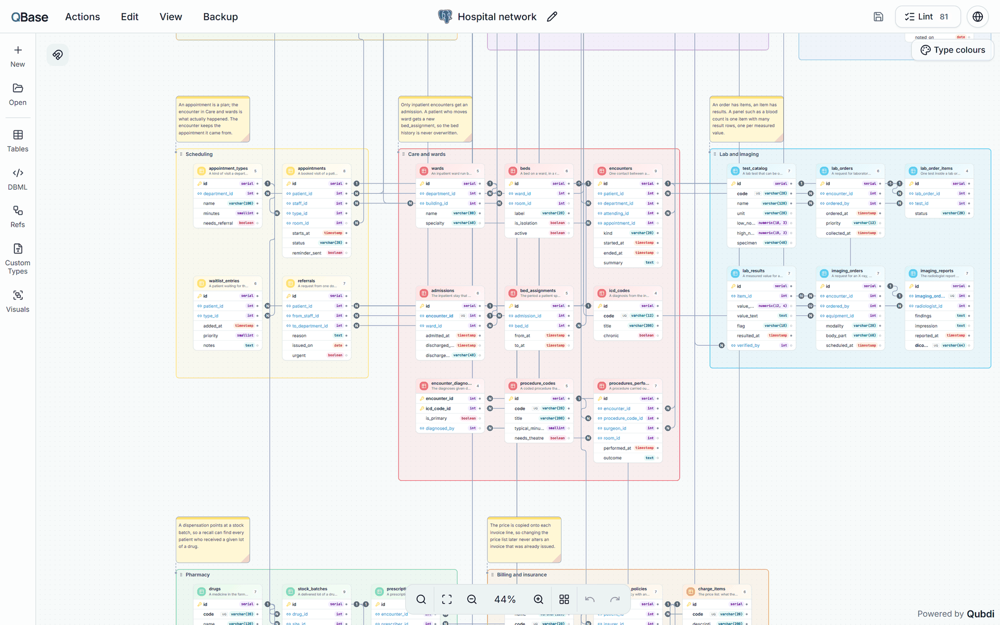
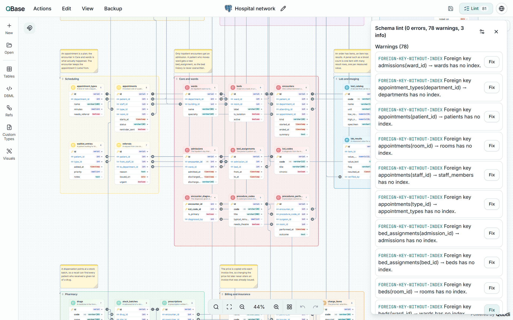

<div align="center">

<h1>
  <picture>
    <source media="(prefers-color-scheme: dark)" srcset="docs/images/logo-dark.svg">
    
  </picture>
</h1>

**Draw your database schema. Keep it on your own server.**

QBase is an open source database diagram editor. Use it on its own in the browser,
or add the self-hosted backend for accounts, share links and live-database import.

[](LICENSE)
[](https://hub.docker.com/r/qubdi/qbase)
[](https://hub.docker.com/r/qubdi/qbase)
[](CONTRIBUTING.md)

[Quick start](#quick-start) • [Features](#features) • [Documentation](#documentation) • [Contributing](#contributing)

<picture>
  <source media="(prefers-color-scheme: dark)" srcset="docs/images/qbase-dark.png">
  
</picture>

</div>

## Features

- **Draw fast.** Tables, relations, coloured areas, sticky notes and descriptions on one canvas. Six databases: MySQL, PostgreSQL, MariaDB, SQLite, SQL Server and Oracle. Light and dark theme, in English, German, French, Italian and Russian.
- **Start from an example.** Six ready-made schemas, one for each database, to see what a finished diagram looks like.
- **Import from a live database.** PostgreSQL and SQL Server, read-only, with protection against SSRF (the server being tricked into reaching your private network) and saved connections kept encrypted.
- **Re-sync.** Read the database again and keep your layout, colours, areas, notes and descriptions. One undo step.
- **Drift detection.** Check a diagram against its live database and see what changed, with an optional webhook.
- **Schema lint.** 12 rules with settings per diagram, safe one-click fixes, an API endpoint and a command line tool for CI.
- **Accounts and permissions.** Email and password (stored as argon2 hashes, with [password rules](docs/security.md#passwords)), owner, editor or viewer per diagram, an audit log, and optional two-factor sign-in with an authenticator app.
- **Published versions and share links.** Viewers see numbered published versions, never your working copy. Share links are read-only, use unguessable tokens, expire, can be revoked, are rate limited, and update live.
- **Nothing leaves your server.** No analytics, no GitHub integration, no social links.

<div align="center">



<sub>Schema lint finds missing indexes and other problems, and fixes the safe ones in one click.</sub>

</div>

## Quick start

You only need [Docker](https://docs.docker.com/get-docker/) with Compose v2. There is nothing to clone or build: Compose pulls the published image and a PostgreSQL for it.

1. **Make a folder and download the compose file.**

   ```bash
   # a folder for QBase's files
   mkdir qbase && cd qbase

   # download the compose file into it
   curl -fsSLO https://raw.githubusercontent.com/Qubdi/QBase/main/docker-compose.yml
   ```

2. **Download the settings file and change the dummy secrets.** The example file is a complete `.env`, with every setting and a comment on each. It ships dummy values for the two required secrets so that QBase can start straight away.

   ```bash
   # save the example settings as your own .env
   curl -fsSL https://raw.githubusercontent.com/Qubdi/QBase/main/.env.example -o .env
   ```

   Open `.env` in an editor and replace the two dummy values with your own. **Do this before the first start:** the dummies are public (they are in this repository), and the database keeps the password it was created with.

   ```bash
   # the password of QBase's own database (letters and digits only)
   POSTGRES_PASSWORD=dummy-db-password-change-me
   # encrypts the database connections you save (at least 32 characters)
   CONNECTION_KEY=dummy-connection-key-change-me-0123456789
   ```

   Make each value with `openssl rand -hex 24`, or choose your own. Keep this file: if `CONNECTION_KEY` is lost or changed, saved database connections can no longer be read. While a dummy value is still in use, the server prints a warning in its log (`docker compose logs app`).

   Everything else has a default that suits one machine, so change it only if you need to: `APP_PORT` (8080), `APP_BIND_IP` to reach QBase from other machines, or `QBASE_VERSION` (remove the `#`) to pin a release. Two more secrets are optional, `SECRETS_KEY` and `SETUP_TOKEN`; the comments in the file explain them.

   On Windows run these commands in Git Bash or WSL, or download `docker-compose.yml` and `.env.example` from the repository in your browser and save them as `docker-compose.yml` and `.env`.

3. **Start QBase.**

   ```bash
   docker compose up -d                     # pulls QBase and PostgreSQL, then starts both
   docker compose ps                        # optional: db should say healthy and app running
   ```

4. **Open the editor and create the first account.**

   ```bash
   docker compose logs app                  # the setup token is printed once in this log
   ```

   Go to <http://localhost:8080> and sign up. The first account becomes the administrator, and the form asks for the setup token from the log.

Day to day, in the same folder:

```bash
docker compose down                           # stop; your data stays in a Docker volume
docker compose up -d                          # start again
docker compose pull && docker compose up -d   # update to the newest release
```

QBase listens on `127.0.0.1` only; see [Run QBase](docs/install.md) to reach it from other machines or to pin a version.

**Only want to try the editor?** With Node 24 (see `.nvmrc`) it runs on its own in your browser, with no server and no account. Diagrams stay in the browser.

```bash
git clone https://github.com/Qubdi/QBase.git
cd QBase
npm install
npm run dev              # http://localhost:5173
```

More ways to run it, such as building the image from a clone, your own PostgreSQL, or running from source with the backend, are in [Run QBase](docs/install.md).

## Documentation

| Guide | What is in it |
| --- | --- |
| [Run QBase](docs/install.md) | Docker with the bundled or your own PostgreSQL, running from source, day-to-day commands |
| [Configuration](docs/configuration.md) | The `.env` files and every backend setting |
| [Security](docs/security.md) | Password rules, two-factor sign-in, read-only database import |
| [Operating QBase](docs/operations.md) | Upgrading, backups, scaling, notes for large installations |
| [Schema lint in CI and the API](docs/api-and-ci.md) | The lint command line tool and the read-only history endpoints |
| [Development](docs/development.md) | Running the tests and the browser checks |

## What is in this repository

| Part | Where | Stack |
| --- | --- | --- |
| Editor | `src/` | React 19, TypeScript, Vite, Tailwind, `@xyflow/react`, Dexie |
| Backend (optional; always in the Docker image) | `server/` | Node 24, Fastify, Drizzle, PostgreSQL |
| Shared logic | `shared/` | Pure TypeScript with no dependencies: `reconcile`, drift classification, `lint` |
| Design references | `design/` | Decision records and screenshots of the interface options that were tried; not part of the app, and left out of the Docker image |
| Agent skills | `.claude/skills/` | Third-party instruction packs for AI coding assistants such as Claude Code; not part of the app, left out of the Docker image, and not covered by QBase's licence (each has its own, see [NOTICE](NOTICE)) |

Supported browsers: Safari 16.4 and newer, Chrome and Edge 111 and newer, Firefox 114 and newer. An older browser shows a short notice asking for an update instead of a blank page.

## Contributing

Contributions are welcome. Read [CONTRIBUTING.md](CONTRIBUTING.md) first; it covers pull requests, commit messages and the contributor licence agreement. Found a bug? [Open an issue](https://github.com/qubdi/qbase/issues/new?labels=bug). Please follow our [Code of Conduct](CODE_OF_CONDUCT.md). To report a security problem, see [SECURITY.md](SECURITY.md).

## License

QBase is licensed under the [Apache License, Version 2.0](LICENSE): free to use, modify, self-host and redistribute, for personal and commercial use alike, including offering it to others as a service. Keep the licence and the [NOTICE](NOTICE) with any copy you distribute, and mark files you changed. Third-party material keeps its own licence (see [NOTICE](NOTICE)); the licence gives no right to use the Qubdi name or logo or the trademarks of the database makers shown in the picker.

## Acknowledgements

QBase is inspired by [ChartDB](https://github.com/chartdb/chartdb), the open source
database diagram editor. The QBase editor was written from scratch and shares no
meaningful code with it; the idea of a quick, friendly diagram editor for SQL
databases is theirs, and we are grateful for it. Other credits (shadcn/ui, the
fonts and the dependencies) are in [NOTICE](NOTICE).
