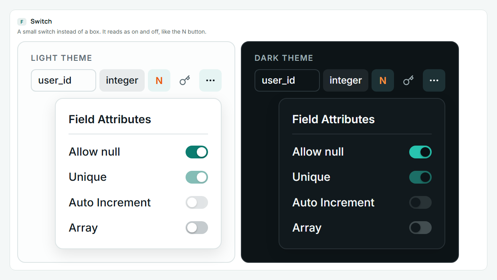
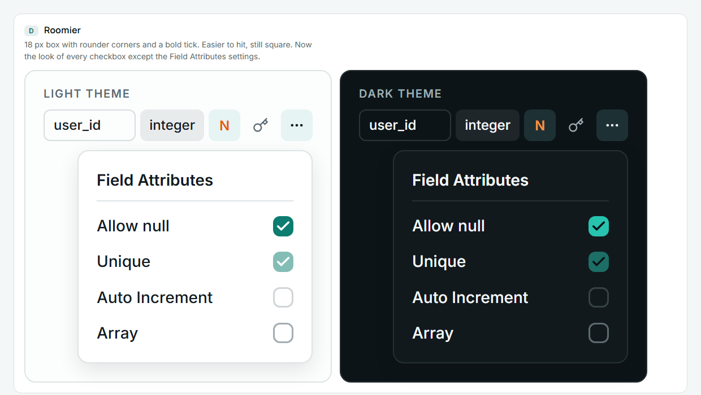

# Checkboxes in Field Attributes, and every other checkbox

Decided 2026-11-17.

## The question

The checkboxes looked out of design: the tick was as big as the box it sat in (a 16 px tick in
a 16 px box), so it touched the edges and looked heavy and crowded. Seven treatments were drawn
in the app's own colours, light and dark, and compared in [`options.html`](options.html).

## Chosen

- **F, Switch** for the yes-or-no settings in Field Attributes.
- **D, Roomier** for every other checkbox.

### F, Switch: the settings in Field Attributes

Allow null, Unique, Auto Increment and Array are small on/off switches. They read as on and off
like the N toggle of the field row, and they have no tick to get wrong.



- Where: `src/platform/ui/switch.tsx`, used in
  `src/features/tables/fields/attributes-popover.tsx`.
- Size: a 28 x 16 px track, a 12 px knob 2 px in from the edge.
- Off: the track is `muted-foreground` at 35 %, the knob the popover colour.
  On: the track is `primary`, the knob `primary-foreground` (a white knob on the light
  theme's deep teal, a near-black knob on the dark theme's bright teal).
- A button with `role="switch"` and `aria-checked`, so a label around it names it and a click
  on the label flips it; Space and Enter work. Disabled is 50 % opacity.
- Allow null is the same setting as the N toggle of the row: change either, the other follows.

### D, Roomier: every other checkbox

The shared `Checkbox` in `src/platform/ui/checkbox.tsx`, used by the settings dialog, export,
import (table picker), lint settings, two-factor and the index editor. Lists to tick and
acknowledgements stay boxes: a switch would be the wrong control there.



An 18 px box with a 6 px corner, a 1.5 px border (`muted-foreground` at 55 %, 85 % on hover
while unticked), and a bold tick drawn smaller than the box (14 px, stroke 3) so it has space
around it. Ticked, the box fills with `primary`.

`rounded-[6px]` is written out on purpose: `rounded-md` follows the theme radius (0.75 rem) and
is too round for a box this size. The box is `bg-background`; inside a popover `bg-popover`
would match the surface exactly, but the difference is slight.

The export dialog's two boxes sit next to the first line of their text and use `mt-px` to line
up (they used `mt-0.5` for the old 16 px box).

## The others, not chosen

| | Look | Why not |
| --- | --- | --- |
| A | Previous: 16 px box, 16 px tick | The tick filled the box (the reason for this record). |
| B | Same box, smaller and heavier tick (13 px, stroke 3.2) | Fixes the tick, but D does that and is easier to hit. |
| C | Soft teal tint with a teal tick, no solid block | Quieter, but a checked box is easier to miss. |
| E | Circle with a small tick | Reads as a radio button. |
| G | B, with Allow null in the orange of the pressed N toggle | Shows the link to N, but breaks the one accent colour. |

## Regenerating the pictures

`options.html` opens in any browser. `options.html?only=F&zoom=2` shows one option, and
`&shot=1` hides the page text. The screenshots were taken with headless Edge:

```
msedge --headless=new --window-size=1240,700 --screenshot=F-switch.png "file:///.../design/checkbox/options.html?only=F&zoom=2&shot=1"
```
