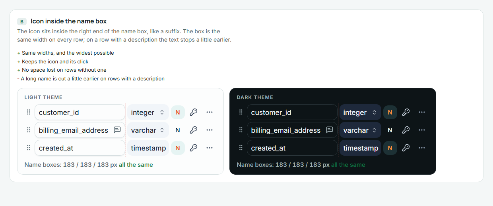

# Description marker in the field rows

Decided 2026-11-17.

## The question

A column with a description showed a small comment icon after its name in the field row. The icon
took 20 px from the row (16 px and a 4 px gap), and the name box is the part of the row that
stretches to fill what is left, so a row with a description had a name box 20 px shorter than the
others. Six ways to fix that were drawn with the app's own colours and compared in
[`options.html`](options.html); [`all-options.png`](all-options.png) shows them all.

## Chosen: B, Icon inside the name box



The icon sits inside the right end of the name box, like a suffix. The box is the same width on
every row, with or without a description, and a row without one loses no space.

- Where: `src/features/tables/fields/fields-editor.tsx`. The name field sits in a box
  (`relative flex min-w-[3.5rem] flex-1`) and the icon is laid over its right end.
- Side panel: the icon is a button (`size-6`, 4 px from the edge). Its tooltip is the
  description, and a click opens Field Attributes, as before.
- Card on the canvas: the icon is no longer a button. The card has no Field Attributes to open,
  so the click did nothing; it now only shows the description as a tooltip (`size-5`, 8 px from
  the edge).
- The text makes room for the icon on the rows that have one: `pr-8` in the side panel, `pr-9` in
  the card. A long name is cut a little earlier there. This is the price of B.
- Tests: `src/features/tables/fields/__tests__/field-description-marker.test.tsx` checks that
  every row is built the same way (the same box, followed straight by the type button), where the
  icon sits, and that only the row with a description gives up text for it. Widths need layout,
  so they were measured in a real browser.

## The others, not chosen

| | Look | Why not |
| --- | --- | --- |
| Today | Icon after the name box, only when there is a description | Name boxes of different widths (the reason for this record). |
| A | Keep the icon, and keep its 16 px place free on every row | Equal widths, but every name box is 20 px shorter, with or without a description. |
| C | No icon; a small dot on the "..." button | Equal and widest, but easy to miss, and the dot means one thing on a button that holds many. |
| D | An icon on every row, faint when there is no description | Shows the state and invites adding one, but costs 20 px on every row and adds an icon to each. |
| E | No icon and no dot; the description is a tooltip on the name box | The cleanest row, but nothing shows that a description exists until you hover or open the popover. |

## Regenerating the pictures

`options.html` opens in any browser. `options.html?only=B&zoom=1.25` shows one option, and
`&shot=1` hides the page text. The pictures were taken with headless Edge:

```
msedge --headless=new --window-size=1240,520 --screenshot=B-icon-inside.png "file:///.../design/field-description/options.html?only=B&zoom=1.25&shot=1"
```
